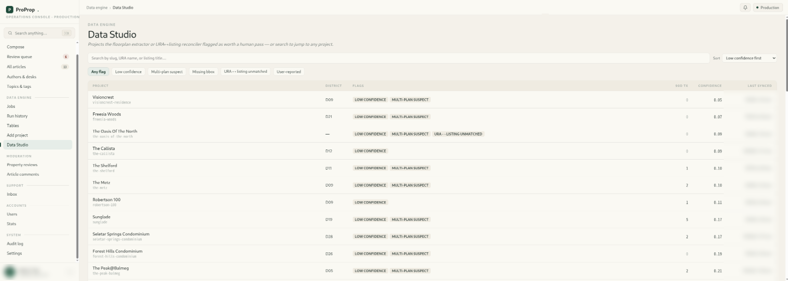
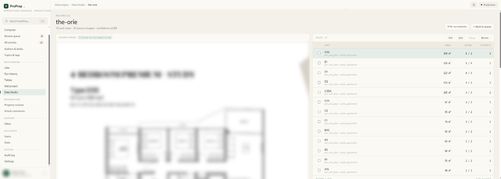
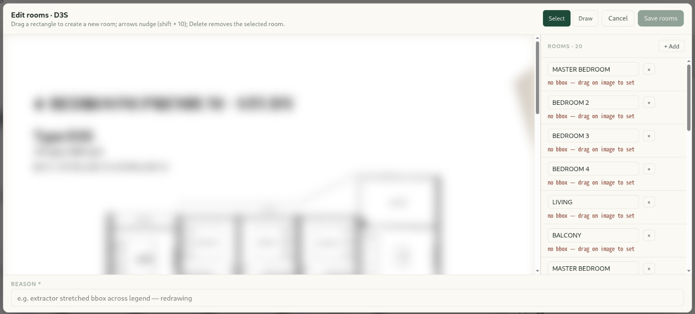

# fpextract

[English](README.md) · **简体中文**

**使用视觉大模型提取户型图中的结构化信息：** 提供不依赖特定厂商的客户端、支持自动分批和崩溃恢复的批量 API、结合 OpenCV 优化的大模型定位，以及带有来源记录和置信度的楼盘级汇总。

本项目从 [ProProp](https://proprop.algonavis.com/) 中独立出来。ProProp 是已投入生产使用的新加坡 AI 房产顾问，这套处理流程已从约 30,000 张户型图中提取结构化住宅单元数据，用于构建顾问知识库。

输入一个户型图文件夹，即可为每张图片生成一条 JSON 记录，包含图纸分类、住宅单元及其房间、面积、卧室数、朝向、裁剪框和房号映射；同时为每个楼盘生成一条汇总记录，包含带来源和置信度的户型、附有证据及冲突记录的房号索引、跃层单元，以及物业类型。汇总和数据质量处理均在本地运行，可重复执行，无需再次调用大模型。

## 特性

- **不依赖特定厂商。** 支持 Anthropic、OpenAI 及兼容 OpenAI 的接口（vLLM、Ollama、LM Studio、DashScope、Azure）。提供两种提示策略：**tool** 模式通过 `tool_choice` 强制调用抽取工具，并提供抽取 schema，但未启用严格模式，输出是否符合 schema 取决于模型和接口；纯 **json** 提示面向不支持函数调用的视觉模型（Qwen3-VL、Qwen2.5-VL、LLaVA 等），支持移除响应中的思维链，并按模型的坐标规则统一边界框格式。
- **支持崩溃恢复的批量 API。** 批量价格为同步调用的一半，任务按厂商限制自动分批；收到 `batch_id` 后立即通过原子重命名写入状态文件。重新运行同一命令，即可恢复状态文件中记录的批次，无需重复提交。如果故障发生在厂商接受批次之后、ID 保存之前，已提交的批次仍可能无法被追踪。
- **结合 OpenCV 优化定位。** 模型先给出每个住宅单元的大致裁剪框，再由 OpenCV 根据图纸实际内容调整边界，支持白色、深色或带品牌底色的背景。还提供背景标准化处理，以及无需模型权重的平铺水印去除功能。
- **汇总结果可追溯。** 跃层单元按层汇总，并保留各层明细；重复图纸按共识规则合并；房号按投票结果归并，并附带 `unit_number_evidence` 和 `conflicts`。住宅单元和楼盘两级均提供置信度，另有数据质量分析和幂等清洗工具。
- **不限制图片来源。** 输入可以是目录树或 JSONL 清单，输出为 JSONL，也可写入 Postgres。

## 快速开始

```bash
pip install fpextract            # core: anthropic + pillow
pip install 'fpextract[cv]'      # + OpenCV for try-crop / try-norm
pip install 'fpextract[openai]'  # + OpenAI-compatible endpoints
```

```bash
export ANTHROPIC_API_KEY=sk-ant-...

# 1. One image → HTML in your browser (crop boxes, rooms, raw JSON). Nothing is written to output/.
fpextract try-one samples/harbour-view/harbour-view-type-a1.png

# 2. Extract a folder (<root>/<project>/*.png). Append-safe: re-runs skip finished images.
fpextract extract --input samples --output out/extractions.jsonl

# 3. Roll up per project. Local, free, regenerable.
fpextract aggregate --extractions out/extractions.jsonl --input samples --output out/projects.jsonl

# 4. Full corpus at half price, resumable.
fpextract extract --input /data/plans --output out/extractions.jsonl --batch
```

`samples/` 下的图片均为合成样例，由 `scripts/make_samples.py` 绘制，采用 CC0 授权。使用命令行处理自有图片的方法见 [`samples/README.md`](samples/README.md)。

## 在 ProProp 中审核抽取结果

在 ProProp 中，处理结果会进入运维后台的 Data Studio，由人工审核抽取器和核对程序标记的楼盘。截图中的户型图来自开发商宣传资料，已做模糊处理；本仓库不附带任何第三方图片。

<table>
<tr><td width="33%" valign="top"><a href="docs/images/proprop-data-studio.png"></a><br><sub><b>Data Studio。</b>需要人工审核的楼盘，按置信度从低到高排列。</sub></td><td width="33%" valign="top"><a href="docs/images/proprop-reconcile.png"></a><br><sub><b>单个楼盘。</b>并排展示原始图纸及提取出的住宅单元信息：面积、卧室数、卫生间数和层数。</sub></td><td width="33%" valign="top"><a href="docs/images/proprop-room-editor.png"></a><br><sub><b>房间编辑器。</b>重新绘制住宅单元内的房间边界框，并填写修改原因，供审计日志记录。</sub></td></tr>
</table>

## 处理流程

```
   <root>/<project>/*.png  or  manifest.jsonl
                  │
                  ▼
   extract ───────────────────► output/extractions.jsonl   one row per image
   (tool | json mode;                 │
    sync | batch)                     ├─► classify   (optional sidecar: sheet type,
                                      │               unit code in image vs filename)
                                      ▼
   aggregate ─────────────────► output/projects.jsonl      one row per project
   (enrich · collapse ·               │
    merge unit numbers)               ├─► dq-profile / dq-clean
                                      └─► sync-pg
```

完整说明、记录结构和参数参考：[docs/PIPELINE.md](docs/PIPELINE.md)（英文）。哪些做法没有成功以及原因：[docs/LESSONS.md](docs/LESSONS.md)（英文）。

## 成本

使用 Sonnet 级别模型时的费用量级：

| | 每张图 | 30,000 张图 |
|---|---|---|
| 同步 | ~$0.022 | ~$660 |
| `--batch` | ~$0.011 | ~$330 |

建议先选几个楼盘试跑（`--limit 3`），检查 `projects.jsonl` 的结果后，再批量处理其余图片。

## 命令

| 命令 | 作用 | API 费用 |
|---|---|---|
| `extract` | 为每张图片生成一条结构化记录；支持同步或批量处理 | 有 |
| `aggregate` | 按楼盘汇总，附带来源记录和置信度 | 无 |
| `classify` | 核查图纸类型及户型代码所在位置 | 有 |
| `try-one` / `try-crop` | 生成单张图片的 HTML 检查页面 | 有 |
| `try-norm` | 生成背景标准化处理及去水印效果的 HTML 检查页面 | 无 |
| `dq-profile` / `dq-clean` | 生成数据质量报告或执行幂等清洗 | 无 |
| `sync-pg` | 将楼盘数据插入或更新至 Postgres | 无 |

`fpextract <command> --help` 列出了每个参数。

## 开发

```bash
pip install -e '.[dev,cv]'
ruff check . && pytest -q
python scripts/make_samples.py   # regenerate the synthetic samples
```

测试使用大模型客户端的测试替身，无需联网。

## 许可

[PolyForm Noncommercial 1.0.0](LICENSE)。个人、研究、教育和其他非商业用途免费。**商业使用需要另行授权**，请联系作者。必须署名：任何副本都要保留 `Required Notice` 一行和 [NOTICE](NOTICE) 文件。合成样例采用 CC0 授权。

Copyright 2026 Mr.Cyprinus (https://github.com/Cyprinus12138)
